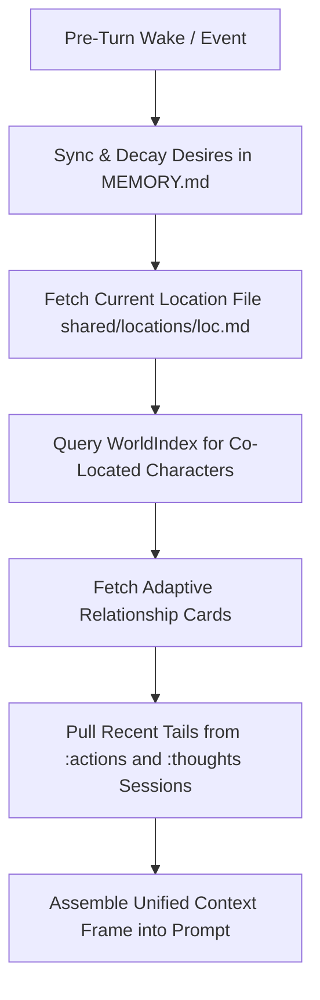

# OpenClaw Primitives Mapping Architecture

Kazusa is built directly on native **OpenClaw primitives** without creating
redundant custom execution engines or relational database tables. This document
explains how every simulation requirement maps to OpenClaw.

---

## 1. Primitives Overview Table

| Simulation Component              | OpenClaw Native Primitive                                       | Implementation Mechanism                                                                                                                                                                                        |
| :-------------------------------- | :-------------------------------------------------------------- | :-------------------------------------------------------------------------------------------------------------------------------------------------------------------------------------------------------------- |
| **Shared Multi-Agent Harness**    | Gateway & Multi-Agent Roster (`agents.entries.*`)               | Each character is an entry in `openclaw.json` mapped to `workspaces/<agent_id>/`. Per-agent `AGENTS.md` files are omitted in favor of the shared simulation harness.                                            |
| **Character Persona**             | Workspace `SOUL.md` & `IDENTITY.md`                             | OpenClaw automatically loads `SOUL.md` (voice, core values) and `IDENTITY.md` (bio). YAML frontmatter in `IDENTITY.md` holds desire targets and decay constants.                                                |
| **Hot Working State**             | Workspace `MEMORY.md`                                           | OpenClaw always injects `MEMORY.md`. YAML frontmatter holds machine state (`location`, `desires`, `active_task`, `alarms`); body holds qualitative desires, goals, and today's plan.                            |
| **Action & Thought Streams**      | OpenClaw Sessions (`agent:<id>:actions`, `agent:<id>:thoughts`) | Separate chronological append-only session transcripts for tool lease lifecycles and internal monologues/pre-imaginations.                                                                                      |
| **Inter-Agent Chat Streams**      | OpenClaw Sessions (`agent:<id>:chat:<peerOrGroup>`)             | 1-on-1 and group communication channels with isolated conversational history.                                                                                                                                   |
| **Social Graph & Cold Archive**   | Workspace `memory/` + `memory-core` plugin                      | Relationship files in `memory/relationships/<peer>.md` (Quick Impression + Interaction Log). Nightly logs in `memory/YYYY-MM-DD.md` indexed via hybrid vector + keyword search (`memory_search`, `memory_get`). |
| **Objective World Map**           | Shared Markdown Files + `WorldIndex`                            | `shared/locations/<loc>.md` contains objective physical setting facts, activities, and connections. In-memory `WorldIndex` tracks agent presence by watching `MEMORY.md` frontmatter.                           |
| **Cross-Stream Context Assembly** | Custom Context Engine (`plugins.slots.contextEngine`)           | Custom plugin implementing `assemble()` before model turns to merge location, stream tails, and adaptive relationship impressions into one unified context.                                                     |
| **Variable-Horizon Heartbeats**   | OpenClaw Automations (`next_check` dynamic pacing)              | Paced automation jobs (`--pacing-min 1m --pacing-max 16h`) let tools set next heartbeat duration dynamically via `next_check` based on task lease duration.                                                     |
| **Pre-Emptive Interrupts**        | `openclaw system event --mode now`                              | Alarms and spatial encounter rolls interrupt sleeping or working agents immediately without waiting for scheduled heartbeats.                                                                                   |
| **Remote Communication**          | OpenClaw `sessions_send(timeoutSeconds=0)`                      | Non-blocking message dispatch across agent chat sessions.                                                                                                                                                       |
| **Behavioral Workflows**          | Shared OpenClaw Skills (`shared/skills/*/SKILL.md`)             | Shared reusable skill folders teaching characters how to plan heartbeats, converse socially, and distill memories before sleep.                                                                                 |

---

## 2. Multi-Session Stream Architecture

Instead of custom SQLite message/event tables, Kazusa uses native OpenClaw
session keys:

1. **`agent:<id>:actions`**:
   - Append-only execution ledger.
   - Records every `start_activity`, `start_transit`, `pause_activity`, and
     `conclude_activity` call with start/end timestamps and outcomes.
2. **`agent:<id>:thoughts`**:
   - Append-only internal cognitive ledger.
   - Records D2A 3-option pre-imaginations, plan reconciliations, and private
     reflections without polluting public chat transcripts.
3. **`agent:<id>:chat:<peer_id>`** (1-on-1) and **`agent:<id>:chat:<group_id>`**
   (Group):
   - Preserves dialogue turns between characters.
   - Dispatched asynchronously via `sessions_send`.

---

## 3. Custom Context Engine Lifecycle (`assemble`)

OpenClaw allows overriding the default context engine via
`plugins.slots.contextEngine = "sim-context-engine"`. The custom engine executes
the following pipeline before every LLM call:

### Adaptive Social Graph Injection Rules:

- **1-on-1 Chat Session (`agent:<a>:chat:<b>`)**:
  - Eagerly injects full `## Quick Impression` from
    `<workspace>/memory/relationships/<b>.md`.
- **Group Chat or Crowded Location**:
  - Calculates salience score $S = \text{affinity} + \text{familiarity} +
    \text{recency\_weight}$.
  - Injects only the **Top-3** most salient character impressions to protect
    context token budget.
  - Informs the LLM: _"You also see Clara and David nearby. Call
    memory_get('relationships/clara.md') if you need details."_

---

## 4. Automation Pacing & Interrupt Handling

### 4.1 Paced Automations (`next_check`)

Each agent runs an automation heartbeat configured with dynamic pacing:

- Command: `openclaw run --agent <id>`
- Pacing flags: `--pacing-min 1m --pacing-max 16h`
- When an agent calls `start_activity(duration_min=45)`, the tool returns
  `{ next_check: "45m" }`.
- OpenClaw schedules the next execution exactly 45 minutes in the future,
  consuming **zero CPU and zero tokens** during the wait.

### 4.2 Immediate Wake Events

When an external stimulus occurs:

- Command:
  `openclaw system event --session-key agent:<id>:main --mode now --payload "<event_json>"`
- Wakes the agent's session instantly.
- Pre-turn hook reconciles the interrupted task (pausing exclusive tasks,
  updating elapsed minutes) before invoking the LLM.

---

## 5. Plugin Architecture & Direct TypeScript Execution

### 5.1 Why the `plugins/` Directory (Zero-Build Workflow)

Monorepo setups that require external build steps (`npm run build`,
`tsc --watch`, `tsup`) introduce latency, file-watcher overhead, and
synchronization issues during development.

Kazusa adopts **direct native TypeScript plugins** located under
`apps/kazusa/plugins/`:

- **Direct Runtime Evaluation**: OpenClaw evaluates TypeScript files
  (`./src/index.ts`) directly at runtime via its embedded loader (Jiti/tsx).
- **Instant Hot-Reload**: Changes to simulation tools, desire decay formulas, or
  context engine hooks take effect immediately on the next execution without
  compilation artifacts.
- **Local Workspace Registration**: Plugins are registered directly in
  `openclaw.json` under
  `plugins.load.paths: ["./plugins/sim-harness", "./plugins/sim-context-engine"]`.
- **Packaging Scope**: Published external plugins require pre-built JavaScript
  entries per the OpenClaw SDK contract, but local workspace plugins operate
  directly on TypeScript sources.

### 5.2 Plugin Separation of Concerns

1. **`plugins/sim-harness`**:
   - **File State Engine**: Atomic YAML frontmatter + Markdown parser and writer
     (`frontmatter.ts`).
   - **Simulation Clock**: `SimClock` interface supporting real and accelerated
     time (`clock.ts`).
   - **Presence Tracker**: In-memory `WorldIndex` tracking agent locations by
     watching `MEMORY.md` headers (`world-index.ts`).
   - **Desire & Homeostasis Engine**: Passive decay math, circadian multipliers
     ($M_{\\text{tod}}$), sleep debt accumulation, squared urgency ranking, and
     D2A qualitative rubric renderer (`desires.ts`).
   - **Simulation Tools**: Registered agent tools (`start_activity`,
     `start_transit`, `conclude_activity`, `record_thought`,
     `conclude_conversation`).
   - **Scheduler & Encounter Gate**: Dynamic heartbeat pacing hook
     (`next_check`), auto-arrival on transit expiration, and zero-LLM encounter
     probability rolls (`encounter-gate.ts`, `scheduler-wake.ts`).

2. **`plugins/sim-context-engine`**:
   - Custom `ContextEngine` registered via
     `api.registerContextEngine("sim-context-engine", ...)`.
   - Bound in configuration to
     `plugins.slots.contextEngine = "sim-context-engine"`.
   - Orchestrates multi-stream context assembly (`assemble(ctx)`) prior to LLM
     generation, combining location affordances, stream tails, and adaptive
     relationship impressions.
