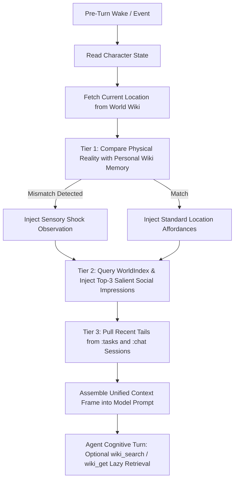

# OpenClaw Primitives Mapping Architecture

**Status:** Perception routing below is the accepted target and draft code. Its
current Gateway adapter is unavailable to local plugins; it is not wired into
root registration. Taskman still uses its existing cron-to-brain path. See
[the runtime blocker](perception.md#current-blocker-openclaw-2026105).

Kazusa is built directly on native **OpenClaw primitives** without creating
redundant custom execution engines or relational database tables. This document
explains how every simulation requirement maps to OpenClaw.

---

## 1. Primitives Overview Table

| Simulation Component                    | OpenClaw Native Primitive                                                            | Implementation Mechanism                                                                                                                                                                                                                                                                              |
| :-------------------------------------- | :----------------------------------------------------------------------------------- | :---------------------------------------------------------------------------------------------------------------------------------------------------------------------------------------------------------------------------------------------------------------------------------------------------- |
| **Shared Multi-Agent Harness**          | Gateway & Multi-Agent Roster (`agents.entries.*`)                                    | Active simulated characters have an entry in `openclaw.json` mapped to `workspaces/<agent_id>/`. Non-simulated background NPCs remain stored in the World Wiki without consuming runner processes.                                                                                                    |
| **Character Persona**                   | Workspace `SOUL.md` & `IDENTITY.md`                                                  | OpenClaw automatically loads `SOUL.md` (voice, core values) and `IDENTITY.md` (bio).                                                                                                                                                                                                                  |
| **Hot Working State**                   | OpenClaw Keyed Plugin State & `MEMORY.md`                                            | OpenClaw Keyed Store (`"tasks"`) stores the active task execution lease (`activeTask`, `agentId`, `updatedAt`) directly in the database. Location is held in spatial subsystem / World Wiki; desires in the `"desires"` keyed store. `MEMORY.md` holds qualitative narrative reflections and goals.   |
| **Task Experiences & Thoughts**         | OpenClaw Session (`agent:<id>:tasks`)                                                | One append-only ledger of task lifecycles, outcomes, and in-character monologues.                                                                                                                                                                                                                     |
| **Inter-Agent & Human Chat Streams**    | OpenClaw Sessions (`agent:<id>:chat:direct:<peer>`, `agent:<id>:chat:group:<group>`) | Private per-character conversation ledgers; Perception gates explicitly submitted text chats separately from their ledger writes. Supports both agent peers and human players (`user:` prefix).                                                                                                       |
| **Human Player (Sensei / User)**        | WebChat / Client Channel + Plugin Config (`pluginConfig.user`)                       | Human players participate in-world without consuming an agent runner process or brain session. They read and send via the character's ledger `agent:<id>:chat:direct:user:<userId>`. `before_dispatch` attributes stimuli and routes to Perception.                                                   |
| **Chat Group Metadata & Delivery**      | OpenClaw Retained Keyed Stores (`"chats"`, `"messaging"`)                            | Retained stores own membership and permanent canonical messages with frozen audiences and projection progress. Native sessions hold private agent projections; human clients read audience-filtered canonical history. All session-orchestration tools are denied (`tools.deny: ["group:sessions"]`). |
| **Cold Archive & Reflection**           | Workspace `memory/` + `memory-core` plugin                                           | Nightly logs in `memory/YYYY-MM-DD.md` indexed via hybrid vector + keyword search (`memory_search`, `memory_get`).                                                                                                                                                                                    |
| **Objective World Wiki (Ground Truth)** | `shared/wiki/` (OpenClaw `memory-wiki` global vault)                                 | Objective ground truth: places (`entities/places/`), full character roster of 100+ characters/NPCs (`entities/characters/`), and canonical concepts (`concepts/<topic>.md`). Mutated only via events or tool leases.                                                                                  |
| **Subjective Personal Wiki (Beliefs)**  | `workspaces/<id>/wiki/` (`memory-wiki` agent vault)                                  | Subjective character mind: private impressions (`entities/characters/`), place memories (`entities/places/`), subjective concepts/claims with evidence (`concepts/<id>.md`), arc syntheses, and contradiction reports (`contradictions.md`).                                                          |
| **3-Tier Context Assembly & Brain**     | `plugins/kazusa/src/context-engine/`                                                 | Context assembly reads simulated-time task/chat history and resolves trusted skill markers. Spatial/social context is future work. Perception owns stimulus routing and a separate lightweight classifier profile.                                                                                    |
| **Variable-Horizon Heartbeats**         | Taskman Autonomous Scheduling                                                        | Taskman automatically schedules the agent's wake-up heartbeat when the active task lease elapses, consuming zero tokens during active tasks.                                                                                                                                                          |
| **Perception**                          | `plugins/kazusa/src/perception/`                                                     | Explicit text ingress, bounded steerable classification, and deterministic task-deadline admission; physical/world events are future adapters.                                                                                                                                                        |
| **Behavioral Workflows**                | Shared OpenClaw Skills (`shared/skills/*/SKILL.md`)                                  | Shared reusable skill folders teaching characters how to plan heartbeats, converse socially, and distill memories before sleep.                                                                                                                                                                       |

---

## 2. Multi-Session Stream Architecture

Instead of custom SQLite message/event tables, Kazusa uses native OpenClaw
session keys:

1. **`agent:<id>:tasks`**:
   - Append-only execution ledger for task leases.
   - Records every `start_task` transition and `delay_task` call with start/end
     timestamps, duration, and outcomes.
   - Tools accept an optional one- or two-sentence `monologue` separately from
     the summary or delay reason. Format it below the factual update as an
     italic blockquote in the same ledger message text; no custom message
     fields, replacement-lease fields, or second stream are needed.
   - Implement a dedicated ledger with the native session-transcript runtime.
     `enqueueSystemEvent` targets a transient event queue and does not append a
     transcript entry.
2. **`agent:<id>:chat:direct:<peer_id>`** (1-on-1) and
   **`agent:<id>:chat:group:<group_id>`** (Group):
   - Each owner's private view preserves only dialogue they participated in.
     Direct and group messages use native `__openclaw` sender metadata, not
     dialogue prefixes. See [the messaging contract](messaging.md).
   - Supports both agent peers (`bob`) and human players (`user:sensei`). For
     human recipients, canonical audience membership grants history access
     without creating agent sessions, fake receipts or brain wakes.
   - Shared group routing metadata (members, titles, creation fingerprints) is
     maintained in the retained `"chats"` keyed store. Permanent messages and
     their per-agent projection progress live in the retained `"messaging"`
     store.
   - Transcripts remain native OpenClaw session files. All session orchestration
     tools (`sessions_*`) are denied to characters via
     `tools.deny: ["group:sessions"]`, ensuring safe operation while
     `memory_search` handles session recall.
   - Messaging appends these ledgers and submits stimuli to Perception; never
     dispatch an agent turn to a ledger via `sessions_send`.

Task monologues already capture character thoughts and experiences; do not add a
separate `:thoughts` stream. See [context engine](context_engine.md) for the
implemented memory layers, simulation timestamps, whole-message selection, and
budgets.

---

## 3. Context Engine Lifecycle & 3-Tier Retrieval

Kazusa's `src/context-engine/` assembles context for `agent:<id>:brain`. It does
not route or admit input. Perception owns that responsibility before a run
starts. Brain assembly reads Clock, not the active-task store; the separate
Perception profile can read the task for urgency. Brain assembly supplies whole
task/chat records within 24 simulated hours, recent brain continuity, and skill
guidance. Records share one remaining budget, then regroup by session.
Spatial/social steps below are future work; do not mutate simulation state
during retryable context assembly:

### 3.1 Tier 1: Eager Spatial Perception & Sensory Shock

Characters never suffer from omniscience leaks; they only learn about physical
world changes when they physically arrive or hear about them:

1. The Kazusa context module reads the current location's objective facts from
   `shared/wiki/entities/places/<location_id>.md`.
2. It inspects the agent's personal memory of that location from
   `workspaces/<id>/wiki/entities/places/<location_id>.md`.
3. If a discrepancy exists (e.g. World Wiki status is `DESTROYED` while Personal
   Wiki records `OPEN`), the engine automatically injects a sensory observation
   notice:
   > **[Sensory Observation]**: _You arrive at Willow Market. The front windows
   > are shattered, blackened rubble blocks the entrance, and caution tape
   > surrounds the building. It has clearly been wrecked._
4. The agent is immediately grounded in physical reality without requiring any
   manual vector recall or tool calls.

### 3.2 Tier 2: Eager Social Salience & Compact Contact Roster

- **Eager Compact Contact Roster (Working Cache)**:
  - Discovers the latest $K$ unique individuals (configurable
    `contactRosterLimit`, default 20) with whom the agent has recently exchanged
    messages or interacted.
  - Pulls each contact's `name`, `peer_id`, `relation_type`, and 1-line
    `summary` from their Personal Wiki card
    (`<workspace>/wiki/entities/characters/<peer_id>.md`).
  - Injects a compact address book section:
    `- Bob Moreno (@bob, close_friend): Music student at Oak Hill Dorm. [chat:direct:bob]`
  - Costs ~150 tokens total for 20 contacts, avoiding the $2\times$ round-trip
    penalty of querying `list_chats` or `wiki_search` before messaging someone,
    and eliminating handle hallucinations.
- **1-on-1 Chat Ledger (`agent:<a>:chat:direct:<b>`)**:
  - Eagerly injects full `## Quick Impression` from
    `<workspace>/wiki/entities/characters/<b>.md`.
- **Group Chat or Crowded Location**:
  - Calculates mathematical salience score: $S = \text{affinity} +
    \text{familiarity} + \text{recency\_weight}$.
  - Injects only the **Top-3** most salient character impressions to protect the
    token budget.
  - Informs the LLM: _"You also see Clara and David nearby. Call
    `wiki_get('entities/characters/clara')` if you need details."_

### 3.3 Tier 3: Lazy Dual-Scope Cognitive Retrieval

When planning, conversing, or investigating theories, agents call
`wiki_search(query, scope)` or `wiki_get(lookup)`:

- **Epistemic Shadowing**: `scope="auto"` searches the agent's **Personal Wiki**
  first (subjective beliefs, private theories, confidence scores) and falls back
  to the **World Wiki** (objective public facts, canon history).
- **Provenance Tagging**: Every retrieved chunk is tagged with its epistemic
  source:
  - `[Personal Memory (Confidence: 0.9)]`
  - `[Personal Belief (Source: Alice, Confidence: 0.6)]`
  - `[Public Town Fact (World Wiki)]`

---

## 4. Automation Pacing & Interrupt Handling

### 4.1 Task Lease Scheduling & Autonomous Wakeups

Taskman autonomously owns the lifecycle and wake-up scheduling for active tasks:

- When an agent calls `start_task(type="...", description="...", duration=45)`,
  Taskman stores the active task lease in plugin state and calculates
  $\text{delayMs} = (\text{duration} \times 60\,000) / \text{speed}$.
- Taskman projects the lease into a native one-shot OpenClaw `at` automation,
  keeping the next wake visible in the dashboard without a process-local timer.
- Each timer is a tool-free headless `script` with explicit `agentId` and
  `delivery: { mode: "none" }`. Successful completion notifies Perception; it
  checks the current task before admitting a brain wake, without an LLM
  classification pass. The task ledger is never an execution session.
- At startup or scheduler reload, `cron_reconciled` reconciles the projection
  from retained task state before wakes can run. A normal task transition
  atomically upserts only its own job using the agent ID as the native cron
  `declarationKey`. The native reconciliation lifecycle runs before the
  scheduler fires overdue jobs. No `before_agent_run` gate is needed for
  headless timers. A single brain session eliminates normal competing task
  transitions.
- No LLM polling during the wait; native cron owns timing.

### 4.2 Perception Admission

See [Perception](perception.md). Different stimuli enter a secondary queue;
Perception checks brain activity and admits a wake, steers a meaningful
distraction, or defers attention. It routes records and cognitive input
separately. Context assembly does not reroute events. Only the lightweight
classifier profile reads active tasks; brain context remains ledger-based.

Taskman submits deadline checks through Perception while retaining dashboard
automations. Inbound chat events enter via the `before_dispatch` claiming hook;
native UI/chat messages are intercepted before unmanaged auto-replying. Admitted
stimuli are delivered to `agent:<id>:brain` via an internal `kazusa` ingress
channel using `dispatchReplyWithBufferedBlockDispatcher` with
`turnAdoptionLifecycle`: active runs are steered mid-flight via
`InboundEventKind: "user_request"`, while idle brains receive followup waking
turns via `InboundEventKind: "room_event"`. Classifier decisions are evaluated
via Jev Decision Model without world-mutating tools.

---

## 5. Plugin Architecture & Direct TypeScript Execution

### 5.1 Why the `plugins/` Directory (Zero-Build Workflow)

Monorepo setups that require external build steps (`npm run build`,
`tsc --watch`, `tsup`) introduce latency, file-watcher overhead, and
synchronization issues during development.

Kazusa adopts **direct native TypeScript plugins** located under
`apps/kazusa/plugins/`:

- **Direct Runtime Evaluation**: OpenClaw evaluates TypeScript files
  (`./src/index.ts`) directly at runtime via its embedded loader (Jiti/tsx).
- **Instant Hot-Reload**: Changes to simulation tools, desire decay formulas, or
  context engine hooks take effect immediately on the next execution without
  compilation artifacts.
- **Local Workspace Registration**: Kazusa is registered directly in
  `openclaw.json` under `plugins.load.paths: ["./plugins/kazusa"]`.
- **Packaging Scope**: Published external plugins require pre-built JavaScript
  entries per the OpenClaw SDK contract, but local workspace plugins operate
  directly on TypeScript sources.

### 5.2 Plugin Separation of Concerns

1. **`plugins/kazusa` (`@kazusa/plugin`)**:
   - **One runtime, separate responsibilities**: Clock provides virtual time,
     Taskman owns leases and automation projection, and ContextEngine reads
     ledgers and assembles context. Perception owns stimulus routing and
     attention admission. The root `src/index.ts` composes implemented modules.
   - **Persistence**: `"clock"` and `"tasks"` remain separate retained native
     keyed-store namespaces, while sharing the `kazusa` plugin identity.
   - **Agent Tools & RPC**: Clock exposes `clock_now`, `clock_set_speed`,
     `clock_advance`, and matching `clock.*` RPC methods; Taskman exposes
     `start_task` and `delay_task`. The context engine injects task context from
     the character's task stream when it assembles a turn.
   - **Scope boundary**: Taskman must not acquire location, transit, desires, or
     social-state responsibilities. It currently owns all Gateway cron jobs; add
     an explicit job family before a second automation owner is introduced. An
     event queue is not a task ledger; keep those roles separate.
   - **Colocated Tests**: `src/clock/clock.test.ts` and
     `src/taskman/taskman.test.ts`.

2. **`plugins/kazusa/src/context-engine/`**:
   - Orchestrates multi-stream context assembly (`assemble(ctx)`) prior to LLM
     generation, combining location affordances, stream tails, and adaptive
     relationship impressions without a cross-plugin API.
   - **Colocated Tests**: `src/context-engine/*.test.ts`.
