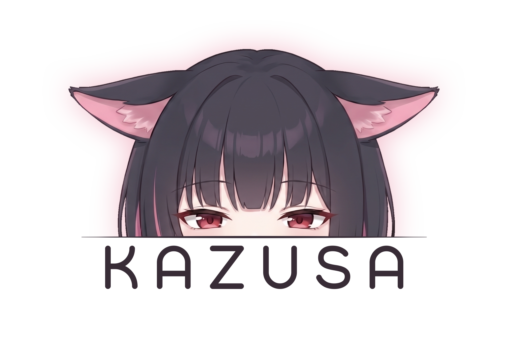
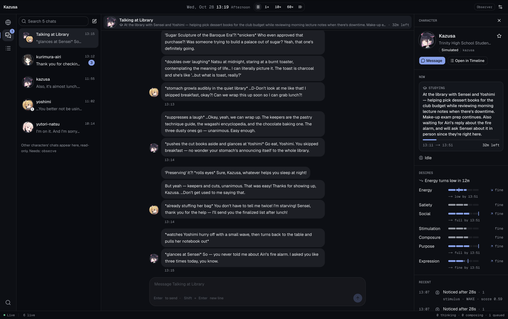
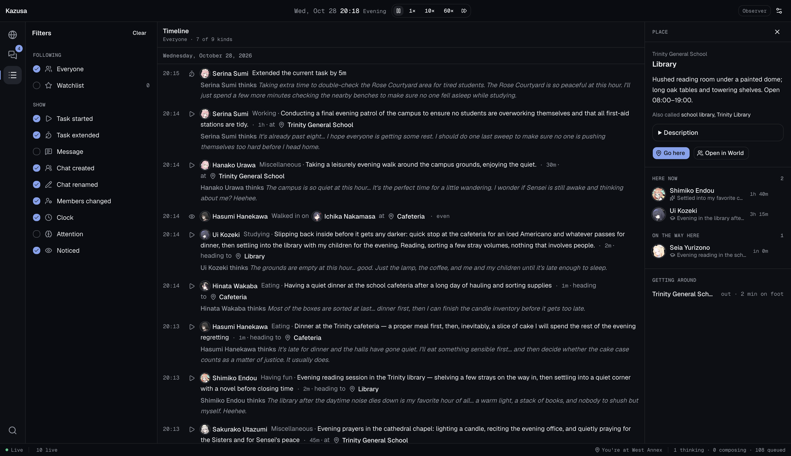

<p align="center">
  <picture>
    <source media="(prefers-color-scheme: dark)" srcset=".github/assets/banner-dark.png" />
    <source media="(prefers-color-scheme: light)" srcset=".github/assets/banner-light.png" />
    
  </picture>
</p>

<p align="center">
  <b>
    Bring your waifus and husbandos alive in a real-time, 24/7 living world.
  </b>
</p>

<p align="center">
  <a href="https://discord.gg/wbNyB85V4X">
    
  </a>
  <a href="https://qm.qq.com/cgi-bin/qm/qr?_wv=1027&k=IBHnmOPB4a0508LQlxoHxHoyZhXjrwWL&authKey=gT763Bb4wyQxkwRoTBQKotA1K8jNasJFooko%2BN528WLeuMqyR2fOlBUYqi0IgXGR&noverify=0&group_code=338067231"></a>
  <a href="https://x.com/f1yingbanana">
    
  </a>
</p>

<p align="center">
  <strong>English</strong> · 
  <a href="./README.zh-CN.md">简体中文</a> ·
  <a href="#features">Features</a> ·
  <a href="#screenshots">Screenshots</a> ·
  <a href="#getting-started">Getting started</a>
</p>

**KAZUSA** is an AI world simulator based on OpenClaw. Import or create your
characters, and **KAZUSA** gives them purpose, needs, goals, and memories. Watch
them chat with each other, plan their next meetup, travel between locations,
manage their priorities, and dream about their future. Put all your favorite
waifus in a room and see how they interact with each other, and with you.

**Import your SillyTavern V2 character cards (.png or .json).** Bring their
personalities, example dialogue, and lorebooks with you. **ARONA**, the built-in
system admin agent, helps turn your existing data into a living world.

**KAZUSA** is built based on leading AI research papers on AI agents and society
simulation, such as
[Generative Agents: Interactive Simulacra of Human Behavior ](https://arxiv.org/abs/2304.03442),
[Project Sid: Many-agent simulations toward AI civilization](https://arxiv.org/html/2411.00114v1)
and
[Simulating Human-like Daily Activities with Desire-driven Autonomy](https://arxiv.org/abs/2412.06435).
**KAZUSA** aims to make large-scale society simulation accessible for everyone,
because your character isn't really alive unless placed in a world they belong
to.

> [!WARNING]
>
> **KAZUSA** is currently in **early development**. Expect bugs and breaking
> changes.

## Features

### 📚 Persistent memory wiki

Characters don't just remember things, they build a mental model of the world
they are in. Every action they perform, place they visit, or interaction with
you updates their impression of the world and leave a lasting mark on their
evolving personality.

### 🧠 Human brain modeling

Characters are driven by AI that closely mirrors how the human brain functions.
They focus on one task at a time, prioritize important tasks over minor
interruptions, and pivot based on context. Complex behavior such as group chats
and conversation pivoting come for free.

### ❤️ Desire-driven actions

Characters plan out their next actions based on current human desires, promises
they've made and long term goals. Actions and the natural flow of time changes
the desire levels to push characters to do realistic and believable things.

### 🔭 Observability

You have complete visibility of what each character is doing. View events on a
timeline showing plans, outcomes and thoughts for all the characters.

### ✈️ Travel and encounters

Characters exist in physical space you define, and move logically across the map
based on their plans and routines. They run into each other naturally, form
groups, converse, and do things together.

### ✨ Agent-based editor

Upload a **SillyTavern V2 PNG or JSON character card** or describe an original
character to the built-in system admin AI, **ARONA**. **ARONA** helps adapt
their personality and lore to your setting, build the world, and set up their
memory wiki.

## Screenshots

Group chat and the character state inspector:

<picture>
  
</picture>

World timeline showing character actions, and location details:

<picture>
  
</picture>

## Getting started

> [!NOTE]
>
> For people that are interested but do not wish to set this up themselves,
> consider [waitlisting here](https://openrp.ai/kazusa). We'll send an email
> once we get this running as a one-click deploy service in the cloud.

You'll need **Node.js 24.16+ (24.x) or 26.1+**, **Git**, and macOS, Linux or
WSL. Then run one command:

```bash
git clone https://github.com/f1yingbanana/kazusa.git && cd kazusa && npm run dev
```

It installs everything and opens a guide at **http://localhost:3000** that asks
for:

1. **A world**: Blue Archive, Elden Ring, or an empty one you build with
   **ARONA**, the built-in system admin.
2. **Who is onstage and when the story begins**, for the ready-made worlds.
3. **An [OpenRouter API key](https://openrouter.ai/keys)**, which powers
   conversation, decisions (**TypeSafe Jev**) and memory search
   (**text-embedding-3-small**). The guide also explains how to set up separate
   providers instead.

Your world lives in `apps/kazusa/world/`, which is never committed. To start
again, stop Kazusa and delete that folder. Run `npm run dev` whenever you want
to come back, and press Ctrl+C once to stop.

### Talk to **ARONA**

Select **ARONA** in the character roster and click **Message**. Attach a **.png
or .json character card** and try:

> Import this character and help me build a small world around them. Ask me
> about the setting, then set up their memory wiki.

You can also describe original characters and ask ARONA to create a draft, then
hand edit their IDENTITY.md or SOUL.md files. You can change the conversational
model at any time in **Settings**.

## Build with us

Help shape a world you would want to spend time in. Original character examples,
small settings, and scenes that expose an unnatural reaction are as useful as
code. [Open an issue](https://github.com/f1yingbanana/kazusa/issues) with what
happened and what you expected, or **star the repository** to follow
development.

## Related projects

- [SillyTavern](https://github.com/SillyTavern/SillyTavern)
- [Generative Agents](https://github.com/joonspk-research/generative_agents)
- [AI Town](https://github.com/a16z-infra/ai-town)
- [AIRI](https://github.com/moeru-ai/airi)
