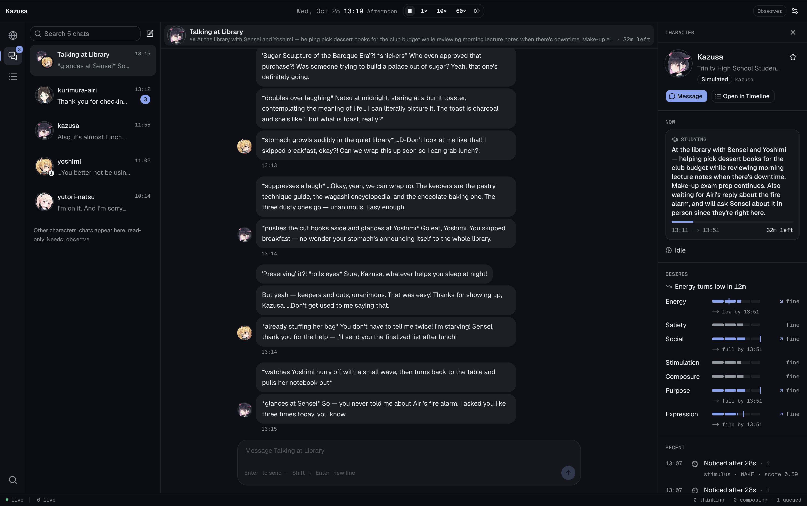

<p align="center">
  <picture>
    <source media="(prefers-color-scheme: dark)" srcset=".github/assets/banner-dark.png" />
    <source media="(prefers-color-scheme: light)" srcset=".github/assets/banner-light.png" />
    
  </picture>
</p>

<p align="center">
  <b>
    Bring your waifus and husbandos (multiple) alive in a real-time, 24/7 living
    world.
  </b>
</p>

<p align="center">
  <a href="https://discord.gg/wbNyB85V4X">
    
  </a>
  <a href="https://x.com/f1yingbanana">
    
  </a>
</p>

<p align="center">
  <strong>English</strong> · <a href="./README.zh-CN.md">简体中文</a>
</p>

<p align="center">
  <a href="#features">Features</a> ·
  <a href="#see-it-in-action">See it in action</a> ·
  <a href="#getting-started">Getting started</a>
</p>

**KAZUSA** (**K**-**A**gent **Z**ero-drift **U**niversal **S**imulation
**A**rchitecture) is a self-hosted AI world simulation sandbox based on
OpenClaw. It simulates all your characters in real-time, 24/7. Import or create
your characters, put them in a world, and watch them chat with each other, plan
their next meetup, travel between locations, manage their needs and priorities,
and dream about their future. While you are busy with your life, their lives
continue in this world.

**Import your SillyTavern V2 character cards (.png or .json).** Bring their
personalities, example dialogue, and lorebooks with you. **ARONA**, the built-in
system admin agent, helps turn your existing data into a living world.

**KAZUSA** is built based on leading AI research papers on AI agents and society
simulation, such as
[Generative Agents: Interactive Simulacra of Human Behavior ](https://arxiv.org/abs/2304.03442),
[Project Sid: Many-agent simulations toward AI civilization](https://arxiv.org/html/2411.00114v1)
and
[Simulating Human-like Daily Activities with Desire-driven Autonomy](https://arxiv.org/abs/2412.06435).
**KAZUSA** aims to bridge the gap between bleeding edge research and much
requested features from the roleplay community, while reducing the cost so it is
not prohibitively expensive to run.

> [!NOTE]
>
> **KAZUSA** is currently in **early development**. Expect bugs and breaking
> changes. Character-card import, ARONA onboarding, and the `setup` / `dev`
> commands below describe the planned first-release experience and are still
> being implemented.

## Features

### 🧠 Human brain modeling

Character brain simulation in **KAZUSA** closely mirrors the human brain.
Realistic behaviors emerge naturally: prioritize studying for an exam over
replying to a text, piovt smoothly when interrupted mid-replying, etc.

### 📚 Persistent memory

Characters learn a mental model of the world they are in. They update an
internal wiki of people, places, ideas and events, even when these change
afterwards. A character's memory in a group chat naturally carries over to a
private chat with another character.

### ❤️ Desire-driven actions

Characters plan out their next actions based on current human desires, promises
they've made, long term goals, and more. Actions and natural flow of time
changes the desire levels to push characters to do something.

### 👥 True group chats

Characters behave naturally in group chats rather than feeling orchestrated, as
they are individual agents capable of prioritizing their current tasks,
assessing the context, and handling interruptions.

### 🔭 Observability

You have complete visibility of what each character is doing. View events on a
timeline showing plans, outcomes and thoughts for all the characters.

### ✈️ Travel and encounters

Characters exist in physical space you define, and move logically across the map
based on their plans and routines. They run into each other naturally, form
groups, converse, and do things together.

### ✨ Agent-based editor

Upload a **SillyTavern V2 PNG or JSON character card**, or describe an original
character, to the built-in system admin AI, **ARONA** (**A**I **R**oleplay
**O**rchestration and **N**arration **A**dministrator). **ARONA** helps adapt
their personality and lore to your setting, build the world, and set up their
memory wiki.

## See it in action

<picture>
  
</picture>

Chat with characters, inspect what they're doing and how they feel, and follow
conversations and activities in the Timeline. Pause or change simulation speed.

## Getting started

You will need an [OpenRouter](https://openrouter.ai) key to power conversation,
decisions, and memory. Alternatively, you can set up models from different
providers with different API keys manually. You or your coding agent can follow
this setup flow.

### 1. Install

You'll need **Node.js 24.16+ (24.x) or 26.1+** and **Git**.

```bash
git clone https://github.com/f1yingbanana/kazusa.git
cd kazusa
npm ci
```

### 2. Enter your API key

Create an [OpenRouter API key](https://openrouter.ai/keys), add credits to your
account, then run:

```bash
npm run setup
```

Paste your key into the setup prompt and accept the default conversational
model, or choose another **tool-capable** model. Setup preconfigures **TypeSafe
Jev** for decisions and **text-embedding-3-small** for memory search using that
same key, connects the frontend, and prepares **ARONA**.

Larger, more capable models can improve characterization and consistency, but
usually cost more and respond more slowly. To customize models or providers,
follow the
[official OpenClaw guide](https://docs.openclaw.ai/concepts/model-providers).

### 3. Launch and talk to **ARONA**

```bash
npm run dev
```

This starts the Gateway and frontend together. Open **http://localhost:3000**,
select **ARONA** in the character roster, and click **Message**. Attach a **.png
or .json character card** and try:

> Import this character and help me build a small world around them. Ask me
> about the setting, then set up their memory wiki.

You can also describe original characters and ask ARONA to create a draft, then
hand edit their IDENTITY.md or SOUL.md files.

## Build with us

Help shape a world you would want to spend time in. Original character examples,
small settings, and scenes that expose an unnatural reaction are as useful as
code. [Open an issue](https://github.com/f1yingbanana/kazusa/issues) with what
happened and what you expected, or **star the repository** to follow
development.

## Related projects

- [SillyTavern](https://github.com/SillyTavern/SillyTavern)
- [Generative Agents](https://github.com/joonspk-research/generative_agents)
- [AI Town](https://github.com/a16z-infra/ai-town)
- [AIRI](https://github.com/moeru-ai/airi)
