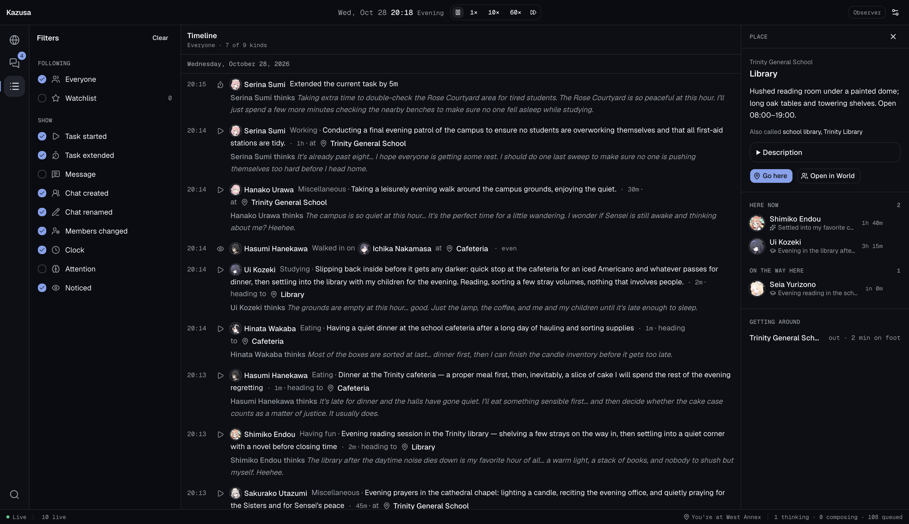

<p align="center">
  <picture>
    <source media="(prefers-color-scheme: dark)" srcset=".github/assets/banner-dark.png" />
    <source media="(prefers-color-scheme: light)" srcset=".github/assets/banner-light.png" />
    
  </picture>
</p>

<p align="center">
  <b>
    让你的赛博老婆与老公们在一个实时运转的世界里活起来。
  </b>
</p>

<p align="center">
  <a href="https://discord.gg/wbNyB85V4X">
    
  </a>
  <a href="https://qm.qq.com/cgi-bin/qm/qr?_wv=1027&k=IBHnmOPB4a0508LQlxoHxHoyZhXjrwWL&authKey=gT763Bb4wyQxkwRoTBQKotA1K8jNasJFooko%2BN528WLeuMqyR2fOlBUYqi0IgXGR&noverify=0&group_code=338067231"></a>
  <a href="https://x.com/f1yingbanana">
    
  </a>
</p>

<p align="center">
  <a href="./README.md">English</a> · 
  <strong>简体中文</strong> ·
  <a href="#功能亮点">功能</a> ·
  <a href="#实机截图">实机截图</a> ·
  <a href="#快速上手">快速上手</a>
</p>

**KAZUSA**
是一个基于 OpenClaw 构建的 AI 世界模拟器。导入或创建你的角色，**KAZUSA**
会赋予他们目标、需求、理想与记忆。看着他们互相聊天、约好下次见面的时间、在不同地点之间奔走、管理各自事务的优先级，甚至畅想未来。把你最喜欢的“老婆”们放进同一个房间，看看她们彼此之间、以及和你之间会擦出怎样的火花。

**直接导入你的 SillyTavern（酒馆）V2 角色卡（.png 或 .json）。**
把他们的人设、对话示例和世界书一并带过来。内置的系统管理员智能体 **ARONA**
会帮你把现有数据变成一个生机勃勃的世界。

**KAZUSA** 的构建基于 AI 智能体与社会模拟领域的顶尖研究论文，例如
[《Generative Agents: Interactive Simulacra of Human Behavior》](https://arxiv.org/abs/2304.03442)、[《Project Sid: Many-agent simulations toward AI civilization》](https://arxiv.org/html/2411.00114v1)
以及
[《Simulating Human-like Daily Activities with Desire-driven Autonomy》](https://arxiv.org/abs/2412.06435)。**KAZUSA**
旨在让大规模社会模拟触手可及——因为只有当角色置身于属于他们的世界中时，他们才算真正活了过来。

> [!WARNING]
>
> **KAZUSA** 目前处于**早期开发阶段**。可能会遇到 Bug 和不兼容的更新。

## 功能亮点

### 📚 持久记忆 Wiki

角色不只是简单地记住事情，他们会在脑海中构建对所处世界的认知模型。他们执行的每一个动作、造访的每一个地点，或是与你的每一次互动，都会更新他们对世界的印象，并在他们不断演化的性格中留下持久的印记。

### 🧠 类人脑建模

角色由高度还原人类大脑运作机制的 AI 驱动。他们一次专注于一项任务，在面对次要打扰时优先处理重要事项，并根据上下文灵活转变话题。像群聊和对话自然切换这类复杂行为，都能水到渠成地实现。

### ❤️ 欲望驱动的行动

角色会根据当下的人类本能需求、许下的承诺以及长期目标来规划接下来的行动。具体的行动和时间的自然流逝会改变各项欲望数值，推动角色做出真实可信的举动。

### 🔭 全景可观测性

你可以完全掌握每个角色的一举一动。通过时间线（Timeline）查看所有角色的计划、行动结果与内心想法。

### ✈️ 移动与偶遇

角色存在于你定义的物理空间中，并会根据自己的计划和日常作息在地图上合乎逻辑地移动。他们会自然地偶遇彼此、结伴同行、交谈，并一起做各种各样的事。

### ✨ 智能体驱动的编辑器

上传一张 **SillyTavern V2 PNG 或 JSON 角色卡**，或者向内置的系统管理员 AI
**ARONA** 描述一个原创角色。**ARONA**
会协助你将他们的人设和背景故事适配到你的世界观中，搭建场景，并初始化他们的记忆 Wiki。

## 实机截图

<picture>
  
</picture>

<picture>
  
</picture>

与角色聊天，查看他们正在做什么、心情如何，并在时间线中追踪对话与活动动态。你还可以随时暂停模拟或调整时间流逝的速度。

## 快速上手

> [!NOTE]
>
> 如果你对项目感兴趣但不想自己部署，可以[在这里加入候补名单](https://openrp.ai/kazusa)。等我们上线一键部署的云端服务后，会第一时间发邮件通知你。

首先需要一个 [OpenRouter](https://openrouter.ai)
密钥来驱动对话、决策和记忆功能。这里你也可以手动配置来自不同服务商的模型并使用对应的 API 密钥。你可以自己按照以下流程操作，也可以直接交给 AI 来跑。

### 1. 安装

你需要先安装 **Node.js 24.16+ (24.x) 或 26.1+** 以及 **Git**。

```bash
git clone [https://github.com/f1yingbanana/kazusa.git](https://github.com/f1yingbanana/kazusa.git)
cd kazusa
npm ci

```

### 2. 输入你的 API 密钥

创建一个 [OpenRouter API 密钥](https://openrouter.ai/keys)，为账户充值后运行：

```bash
npm run setup

```

在安装引导提示中粘贴你的密钥，接受默认的对话模型，或选择其他支持工具调用的模型。安装会使用同一个密钥预先配置好用于决策的
**TypeSafe Jev** 和用于记忆检索的 **text-embedding-3-small**，连接前端，并初始化
**ARONA**。

参数更大、能力更强的模型可以提升角色还原度和前后一致性，但成本更高、响应更慢。如需自定义模型或服务商，请参考
[OpenClaw 官方指南](https://docs.openclaw.ai/concepts/model-providers)。

> [!NOTE]
>
> 理论上是可以不用Jev和embedding的，但是不用前者会大大降低处理多线程事件的速度，后者会大大降低概念搜索的准确度

### 3. 启动并与 **ARONA** 对话

```bash
npm run dev
```

这会同时启动前后端。在浏览器打开 **http://localhost:3000**，在角色列表中选择
**ARONA**，然后点击 **Message**。附上一张 **.png 或 .json 角色卡**，试着发送：

> 帮我导入这个角色，并围绕 TA 搭建一个小世界。先问我关于世界观设定的问题，然后帮 TA 设置好记忆 Wiki。

你也可以直接描述原创角色，让 ARONA 先生成一份初稿，之后再手动编辑他们的
`IDENTITY.md` 或 `SOUL.md` 文件。

## 参与共建

一起来塑造一个你也想沉浸其中的世界吧。原创角色示例、小型世界观设定，或是能暴露出角色反应不自然的对话场景，对我们来说非常宝贵。欢迎[提交问题](/issues)
告诉我们发生了什么以及你想要得到什么样的预期效果，或者点个免费的星星以追踪开发进度。

## 相关项目

- [SillyTavern](https://github.com/SillyTavern/SillyTavern)
- [Generative Agents](https://github.com/joonspk-research/generative_agents)
- [AI Town](https://github.com/a16z-infra/ai-town)
- [AIRI](https://github.com/moeru-ai/airi)
