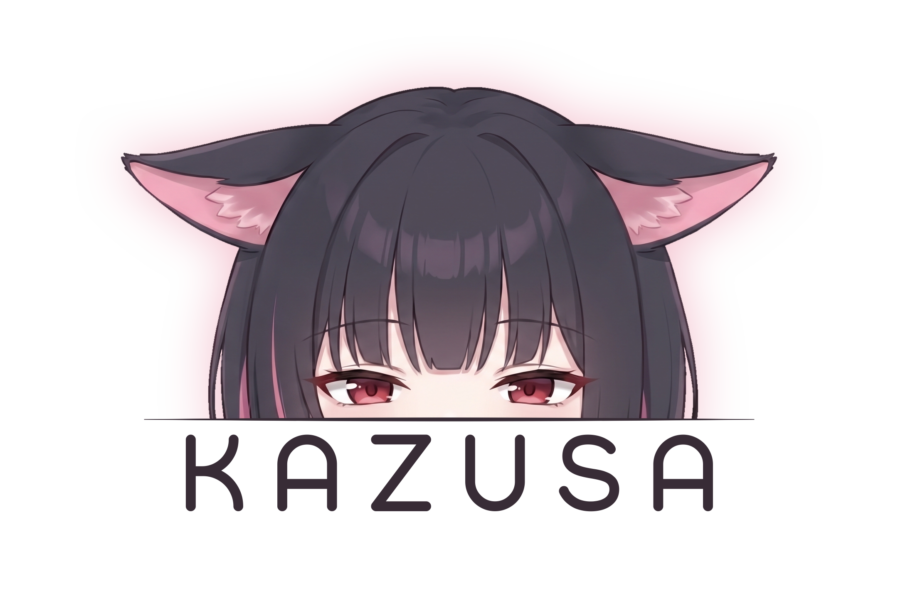
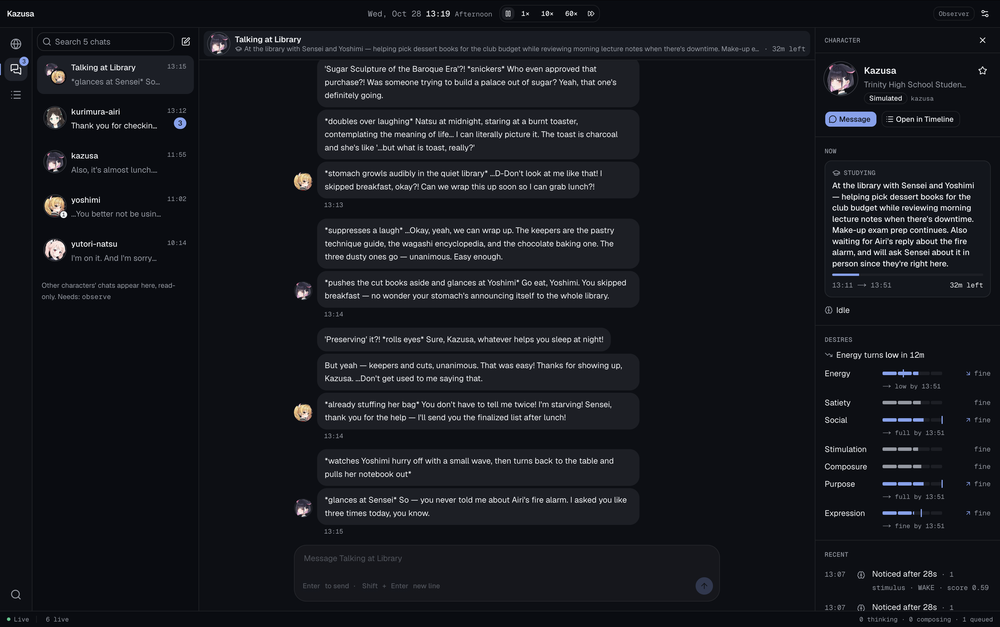
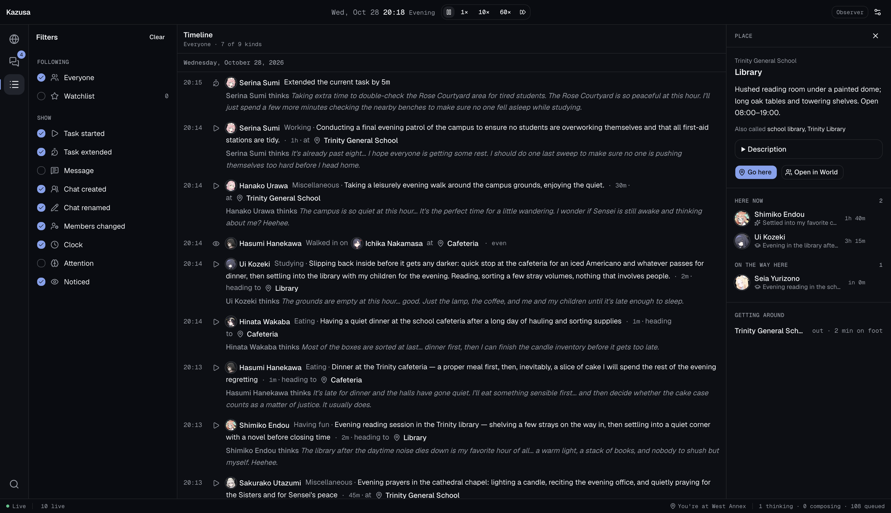

<p align="center">
  <picture>
    <source media="(prefers-color-scheme: dark)" srcset=".github/assets/banner-dark.png" />
    <source media="(prefers-color-scheme: light)" srcset=".github/assets/banner-light.png" />
    
  </picture>
</p>

<p align="center">
  <b>
    让你的赛博老婆老公们在一个实时运转的世界里活起来。
  </b>
</p>

<p align="center">
  <a href="https://discord.gg/wbNyB85V4X">
    
  </a>
  <a href="https://qm.qq.com/cgi-bin/qm/qr?_wv=1027&k=IBHnmOPB4a0508LQlxoHxHoyZhXjrwWL&authKey=gT763Bb4wyQxkwRoTBQKotA1K8jNasJFooko%2BN528WLeuMqyR2fOlBUYqi0IgXGR&noverify=0&group_code=338067231"></a>
  <a href="https://x.com/f1yingbanana">
    
  </a>
</p>

<p align="center">
  <a href="./README.md">English</a> · 
  <strong>简体中文</strong> ·
  <a href="#功能亮点">功能</a> ·
  <a href="#实机截图">实机截图</a> ·
  <a href="#快速上手">快速上手</a>
</p>

**KAZUSA** 是一个基于 OpenClaw 构建的 AI 世界模拟器。**KAZUSA**
赋予你的角色目标、需求、理想与记忆。你可以看着他们聊天、约好下次哪里见面、在不同地点之间奔走、优先处理各自事务，甚至畅想他们的未来。把你最喜欢的角色一同放进一个房间，看看他们彼此之间、以及和你之间会发生什么故事吧。

**直接导入你的角色卡。**
把他们的人设、对话示例和世界设定一并带过来加入你的世界。内置的系统管理员
**ARONA** 会帮你把现有数据变成一个可运行的鲜活世界。

**或者直接手搓一个完整的世界。** 你只管提需求，**ARONA**
就会自己去查资料、把你的专属世界搭建起来：角色、人际关系、地点、设定、秘密……一句话全搞定。

**KAZUSA** 的构建基于 AI 智能体与社会模拟领域的顶尖论文，例如
[《Generative Agents: Interactive Simulacra of Human Behavior》](https://arxiv.org/abs/2304.03442)、[《Project Sid: Many-agent simulations toward AI civilization》](https://arxiv.org/html/2411.00114v1)
以及
[《Simulating Human-like Daily Activities with Desire-driven Autonomy》](https://arxiv.org/abs/2412.06435)。**KAZUSA**
旨在让普通人也能跑上大规模社会模拟器——因为只有被放在属于他们的世界里，你的角色才真正地活了过来。

> [!WARNING]
>
> **KAZUSA**
> 目前处于**早期开发阶段**。可能会遇到各种奇奇怪怪的 Bug 和不兼容的破坏性更新。

## 功能亮点

### 📚 持久记忆 Wiki

角色不只是简单地记住事情，他们会在脑海中构建对所处世界的认知模型。他们执行的每一个动作、造访的每一个地点，或是与你的每一次互动，都会更新他们对世界的印象，并在他们不断演化的性格中留下持久的印记。

### 🧠 类人脑建模

角色由高度还原人类大脑运作机制的 AI 驱动。他们一次专注于一项任务，在面对次要打扰时优先处理重要事项，并根据上下文灵活转变话题。像群聊和对话自然切换这类复杂行为，都能水到渠成地实现。

### ❤️ 欲望驱动的行动

角色会根据当下的人类本能需求、许下的承诺以及长期目标来规划接下来的行动。具体的行动和时间的自然流逝会改变各项欲望数值，推动角色做出真实可信的举动。

### 🔭 全景可观测性

你可以完全掌握每个角色的一举一动。通过时间线（Timeline）查看所有角色的计划、行动结果与内心想法。

### ✈️ 移动与偶遇

角色存在于你定义的物理空间中，并会根据自己的计划和日常作息在地图上合乎逻辑地移动。他们会自然地偶遇彼此、结伴同行、交谈，并一起做各种各样的事。

### ✨ 智能体驱动的编辑器

内置的系统管理员 **ARONA**
能帮你修改现有角色，或者从零手搓新角色。随口说出你的脑洞、想搭建的世界、或者对现有世界的修改建议，**ARONA**
都能直接帮你一键搞定。

## 实机截图

群聊和人物详情面板：

<picture>
  
</picture>

世界时间线上的人物活动记录，和地点详情面板：

<picture>
  
</picture>

## 快速上手

> [!NOTE]
>
> 如果你对项目感兴趣但不想自己部署，可以[在这里加入候补名单](https://openrp.ai/kazusa)。等我们上线一键部署的云端服务后，会第一时间发邮件通知你。

**从 [Releases](https://github.com/f1yingbanana/kazusa/releases/latest)
下载 Windows 或 Mac 安装包**，或者按下面的步骤用 npm 安装。

你需要先安装 **Node.js 24.16+ (24.x) 或 26.1+** 以及
**Git**。打开终端运行（或者直接甩给你的 AI 帮你跑）：

```bash
git clone https://github.com/f1yingbanana/kazusa.git && cd kazusa && npm run dev
```

它会自动装好一切，并在 **http://localhost:3000** 帮你初始化你的世界：

1. **选择一个世界**：从示例世界中挑选一个，或者选择空白世界让你自由发挥。
2. **登场角色与故事起始时间**：对于示例世界，挑选哪些角色在世界启动时主动登场推演。
3. **一个模型供应商的密钥**：一个
   [OpenRouter API 密钥](https://openrouter.ai/keys)就能搞定对话、决策和记忆搜索。你也可以先跳过这步之后自行在设置里选择自己的供应商。

你的世界数据存放在 `apps/kazusa/world/`。需要重新设置的话，只要按 Ctrl +
C 停止 Kazusa，把那个文件夹删掉即可。重新跑 `npm run dev` 就会初始化。

更新在**设置 > 更新**里。Kazusa会下载新版本并重启，你的世界会保留。世界的作者发布新版本时，同一页面也会提示，由
**ARONA** 把新版本并入你的世界，世界里发生过的一切都会保留。

由旧版 Kazusa 创建的世界（在世界改为直接从作者处下载之前）无法再更新或运行。Kazusa 会提示你开始一个新世界，旧世界会保存在
`apps/kazusa/old-worlds/` 里。请准备好你的 API 密钥：设置时需要重新填写。

### 与 **ARONA** 对话

**ARONA** 是内置的系统管理员智能体，专门带你一起搭建世界。

你可以向 **ARONA**
描述原创角色并让它生成一份初稿，之后直接在本地硬盘上手动编辑他们的 `IDENTITY.md`
或 `SOUL.md` 文件（位于 `world/workspaces/[character-id]/` 下）。

你甚至可以让 **ARONA**
从零直接手搓一个完整的世界。如下例生成一个**东方**的世界：

```
Create the world of Touhou Project. Examine the level of detail in the example
worlds listed in apps/kazusa/world-sources.json: the settings, characters,
locations, and memory wikis. We need to recreate the same level of detail. Search online for your
source of information. Report your progress at each stage.
```

> [!NOTE]
>
> 想围观 **ARONA**
> 的实时进度，可以点击她角色详情侧边栏上的**大脑**图标，窥探她的内心思考过程。

为了安全起见，新创建的角色默认都是候场状态（off-stage）。你可以让 **ARONA**
把这些角色请上台，或者自己在 World 页里手动切换。

> [!NOTE]
>
> 你也可以用 **Claude Code**
> 或者其他的编程 AI 来做这件事。仓库自带了它所需的所有技能。一般这还会更快，因为编程 AI 在上网搜索和编写文件方面会比 OpenClaw 的更加高效。

## 参与共建

一起来塑造一个你也想沉浸其中的世界吧。原创角色示例、小型世界观设定，或是能暴露出角色反应不自然的对话场景，对我们来说都和代码一样宝贵。欢迎[提交 Issue](https://github.com/f1yingbanana/kazusa/issues)
告诉我们发生了什么以及你期望的反应。

欢迎给本仓库**点个 Star（点颗星星）**关注最新进展，也可以[加入我们的 Discord](https://discord.gg/wbNyB85V4X)
一起交流探讨。

## 相关项目

- [SillyTavern](https://github.com/SillyTavern/SillyTavern)
- [Generative Agents](https://github.com/joonspk-research/generative_agents)
- [AI Town](https://github.com/a16z-infra/ai-town)
- [AIRI](https://github.com/moeru-ai/airi)
